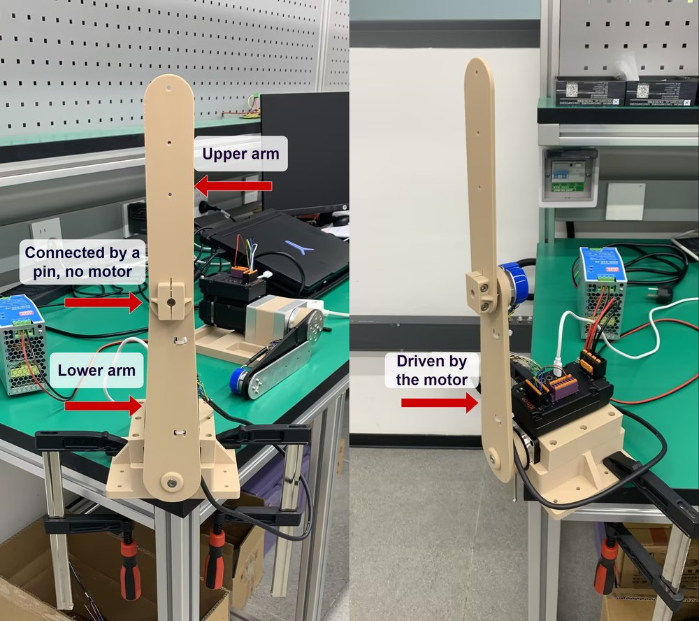

# Delivery Notes

## 1. Project Overview

This project implements a double-pendulum balancing and swing-up task based on an **iSMD integrated servo motor**.


The system has **two degrees of freedom (upper-arm angle, lower-arm angle) but only one actuator**, making it a typical **underactuated system**:

| Link | Actuation |
|---|---|
| **Lower arm** | **Directly driven** by the iSMD motor (only actuator) |
| **Upper arm** | **No independent actuation** — moves via dynamic coupling torque from the lower arm and gravity torque |



**Current capabilities**: The double-pendulum system achieves autonomous swing-up and balancing, bringing both arms upright and keeping them balanced there. More features will be developed on this platform.

**Closed-loop tech stack**:

```
Isaac Sim + Isaac Lab (simulation) → skrl PPO (policy training) → mcontrol driver (real-robot deployment)
```

Forming a complete **simulation → training → real-robot deployment** pipeline.

### 1.1 Underactuated Control

Most of the pendulum links are **3D-printed parts**. An iSMD integrated servo motor is mounted at the bottom, directly driving the lower arm to rotate; the upper arm is connected to the lower arm via a **cylindrical pin** and has no independent actuation.

The motor torque acts on the lower arm first: the acceleration / deceleration of the lower arm generates force through **joint coupling**, which, combined with the **gravity effect**, drives the upper arm to swing passively.

```
iSMD motor (bottom) ──drives──> lower arm ──pin joint──> upper arm (passive)
                               │
      motor torque → coupling force + gravity torque → upper arm swings
```

### 1.2 State Acquisition

**Lower arm**: The angle is read directly from the **16-bit magnetoelectric multi-turn absolute encoder** built into the iSMD, and the angular velocity is read from the driver's **velocity register**.

**Upper arm**: The real-time angle is acquired via an external **incremental encoder**, whose A/B phase differential signals are connected to the **differential signal input port** of the iSMD. This port supports differential inputs up to **500 kHz**; together with the driver's internal high-speed counter, it enables real-time sampling of the upper arm angle. The angular velocity is obtained by **numerical differentiation of the position**.

### 1.3 Communication

The host computer communicates with the iSMD driver over an **RS232 serial port**, continuously exchanging commands at a fixed control frequency:

1. In each control cycle, the driver sends back the state of the lower and upper arms to the host;
2. The host runs the RL policy and generates a torque command;
3. The driver executes the command and updates the motor torque output.

---

## 2. Project Information

- **Version**: v1.0.0
- **Delivery date**: 2026-08-04
- **Contents**: Kinco Motor Control SDK, double pendulum simulation & deployment project, hardware installation manual, and demonstration videos.

---

## 3. Directory Structure

```text
├── README.md                                           # Delivery notes
├── Double_Pendulum_Arm_Kit_Installation_Manual_EN.pdf  # Hardware installation manual
├── Kinco-Motion-Control-SDK-main/                      # Kinco Motor Control SDK: Communicate with drives via RS232/RS485, PCAN, or CxCAN.
│   ├── libs/                                           # Dynamic libraries (.dll / .so / .dylib)
│   ├── examples/                                       # Example programs
│   │   └── example.py                                  # Python API examples
│   └── README.md                                       # SDK Setup and Usage
├── iSMD60D_DoublePendulum_3DP_delivery/                # Double pendulum simulation and deployment project
│   ├── scripts/                                        # Training / playback / deployment entry points
│   ├── source/                                         # Isaac Lab extension and hardware driver
│   ├── models/                                         # USD / USDZ robot assets
│   ├── logs/                                           # Training logs and checkpoints
│   └── ...                                             # Remaining project files
└── Media/                                              # Demonstration video
```
