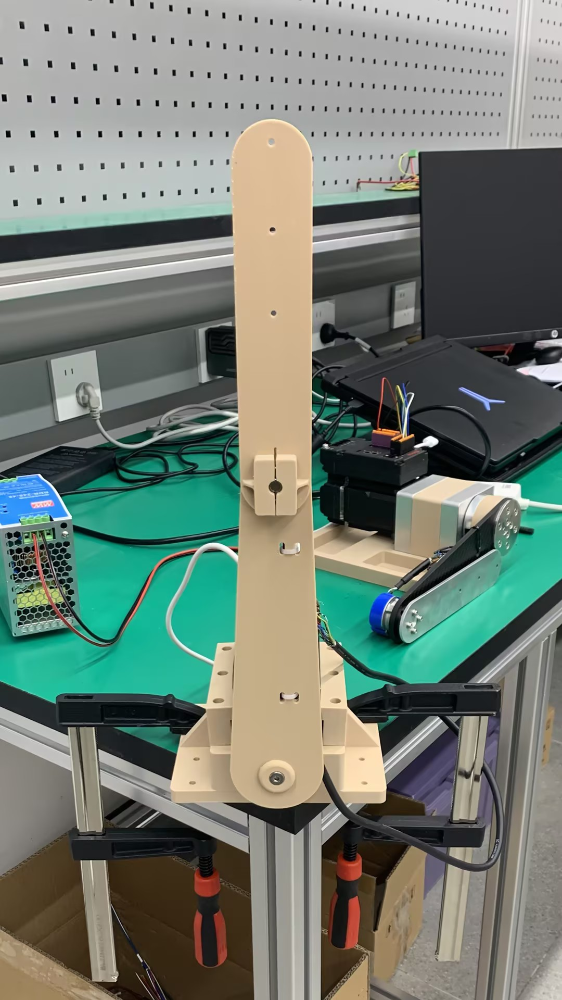

# Double Pendulum RL Control Based on iSMD Integrated Servo Motor

   

> Isaac Lab reinforcement learning training and Sim-to-Real deployment for a 3D-printed double pendulum driven by an iSMD60D integrated servo motor.

- Environment registration ID: `Template-Ismd60d-Doublependulum-3dp-v0`
- Training framework: Isaac Lab `ManagerBasedRLEnv` + skrl PPO
- Hardware driver: `mcontrol_driver.py` (RS232 communication, torque control)

---

## Project Overview

This project implements a double-pendulum balancing and swing-up task based on an **iSMD integrated servo motor**. Demonstration videos are available in the [Media/](../Media/) folder. The system has **two degrees of freedom (upper-arm angle, lower-arm angle) but only one actuator**, making it a typical **underactuated system**:

| Joint | Actuation |
|---|---|
| **Lower arm** | **Directly driven** by the iSMD motor (only actuator) |
| **Upper arm** | **No independent actuation** — moves via dynamic coupling torque from the lower arm and gravity torque |

**Current capabilities**: The double-pendulum system achieves **swing-up and balancing**; the upper arm can swing up from the downward position to the upright position, and swing/maintain balance near the upright position. More features will be developed on this platform.

**Closed-loop tech stack**:

```
Isaac Sim + Isaac Lab (simulation) → skrl PPO (policy training) → mcontrol driver (real-robot deployment)
```

Forming a complete **simulation → training → real-robot deployment** pipeline.

## Notes

> Read this section carefully before real-robot deployment to avoid hardware damage or failure to drive the motor.

1. **Serial port configuration**: Before real-robot control, confirm that the port number are correct. The configuration is located at the top of
   `scripts/skrl/deploy_ismd60d_doublependulum_3dp.py`:

   ```python
   SERIAL_PORT = "COM3"      # Modify according to your actual device
   ```

2. **Read the manual before deploying**: Before running the deployment script, read
   [Double_Pendulum_Arm_Kit_Installation_Manual_EN.pdf](../Double_Pendulum_Arm_Kit_Installation_Manual_EN.pdf),
   which covers the pendulum-arm assembly and wiring. **Power on the 48V supply first, then connect the
   USB Type-C communication cable** — otherwise the motor drive will raise hardware faults when running the deployment script.
   
3. **Initial pose**: The upright balancing of the double pendulum is relatively sensitive to the initial pose. As shown in the figure, before running the deployment program, place both arms in the vertical upright position. Tilt the upper arm slightly to the left, this provides the upper arm with an initial leftward bias to counteract its tendency to tip to the right during balancing. (The reason is that under the current environment configuration, the trained policy tends to shift the upper arm to the right during balancing.)

   
   
4. **Timeout protection**: If the deployment script runs on a non-real-time system, the control frequency may be unstable, which can degrade the robot's motion performance. In the event of a long blocking delay, the motor drive will continue to hold the torque command from the previous moment, causing the pendulum arm to become unstable. To address this, the deployment script deploy_ismd60d_doublependulum_3dp.py has been configured to write self._ctrl.write_int(REG_COMM232_TIMEOUTGUARD, "Uint16", 200), so that the motor drive automatically disables itself when the blocking time is too long. In addition, safety protection measures must be in place and real-time hardware should be used.
      
5. **Safety**: Before real-robot experiments, ensure the mechanical structure is securely installed, maintain a safe distance between personnel and the equipment, and prepare an emergency stop method.
   
6. **Extending the Demo**: The current environment configuration can be modified, and the policy retrained to achieve better motion performance. Multiple policies can also be trained for different motions, and these policies can be combined for demonstration.

## Hardware Structure

### 1. Underactuated Control

Most of the pendulum links are **3D-printed parts**. An iSMD integrated servo motor is mounted at the bottom, directly driving the lower arm to rotate; the upper arm is connected to the lower arm via a **cylindrical pin** and has no independent actuation.

The motor torque acts on the lower arm first: the acceleration / deceleration of the lower arm generates force through **joint coupling**, which, combined with the **gravity effect**, drives the upper arm to swing passively.

```
iSMD motor (bottom) ──drives──> lower arm ──pin joint──> upper arm (passive)
                               │
      motor torque → coupling force + gravity torque → upper arm swings
```

### 2. State Acquisition

**Lower arm**: The angle is read directly from the **16-bit magnetoelectric multi-turn absolute encoder** built into the iSMD, and the angular velocity is read from the driver's **velocity register**.

**Upper arm**: The real-time angle is acquired via an external **incremental encoder**, whose A/B phase differential signals are connected to the **differential signal input port** of the iSMD. This port supports differential inputs up to **500 kHz**; together with the driver's internal high-speed counter, it enables real-time sampling of the upper arm angle. The angular velocity is obtained by **numerical differentiation of the position**.

### 3. Communication

The host computer communicates with the iSMD driver over an **RS232 serial port**, continuously exchanging commands at a fixed control frequency:

1. In each control cycle, the driver sends back the state of the lower and upper arms to the host;
2. The host runs the RL policy and generates a torque command;
3. The driver executes the command and updates the motor torque output.

# Template for Isaac Lab Projects

## Overview

This project/repository serves as a template for building projects or extensions based on Isaac Lab.
It allows you to develop in an isolated environment, outside of the core Isaac Lab repository.

**Key Features:**

- `Isolation` Work outside the core Isaac Lab repository, ensuring that your development efforts remain self-contained.
- `Flexibility` This template is set up to allow your code to be run as an extension in Omniverse.

**Keywords:** extension, template, isaaclab

## Installation

- Install Isaac Lab by following the [installation guide](https://isaac-sim.github.io/IsaacLab/main/source/setup/installation/index.html).
  We recommend using the conda or uv installation as it simplifies calling Python scripts from the terminal.

- Clone or copy this project/repository separately from the Isaac Lab installation (i.e. outside the `IsaacLab` directory):

- Using a python interpreter that has Isaac Lab installed, install the library in editable mode using:

    ```bash
    # use 'PATH_TO_isaaclab.sh|bat -p' instead of 'python' if Isaac Lab is not installed in Python venv or conda
    python -m pip install -e source/iSMD60D_DoublePendulum_3DP
    ```

- Verify that the extension is correctly installed by:

    - Listing the available tasks:

        Note: It the task name changes, it may be necessary to update the search pattern `"Template-"`
        (in the `scripts/list_envs.py` file) so that it can be listed.

        ```bash
        # use 'FULL_PATH_TO_isaaclab.sh|bat -p' instead of 'python' if Isaac Lab is not installed in Python venv or conda
        python scripts/list_envs.py
        ```

    - Running a task:

        ```bash
        # use 'FULL_PATH_TO_isaaclab.sh|bat -p' instead of 'python' if Isaac Lab is not installed in Python venv or conda
        python scripts/<RL_LIBRARY>/train.py --task=<TASK_NAME>
        ```

    - Running a task with dummy agents:

        These include dummy agents that output zero or random agents. They are useful to ensure that the environments are configured correctly.

        - Zero-action agent

            ```bash
            # use 'FULL_PATH_TO_isaaclab.sh|bat -p' instead of 'python' if Isaac Lab is not installed in Python venv or conda
            python scripts/zero_agent.py --task=<TASK_NAME>
            ```
        - Random-action agent

            ```bash
            # use 'FULL_PATH_TO_isaaclab.sh|bat -p' instead of 'python' if Isaac Lab is not installed in Python venv or conda
            python scripts/random_agent.py --task=<TASK_NAME>
            ```

### Set up IDE (Optional)

To setup the IDE, please follow these instructions:

- Run VSCode Tasks, by pressing `Ctrl+Shift+P`, selecting `Tasks: Run Task` and running the `setup_python_env` in the drop down menu.
  When running this task, you will be prompted to add the absolute path to your Isaac Sim installation.

If everything executes correctly, it should create a file .python.env in the `.vscode` directory.
The file contains the python paths to all the extensions provided by Isaac Sim and Omniverse.
This helps in indexing all the python modules for intelligent suggestions while writing code.

### Setup as Omniverse Extension (Optional)

We provide an example UI extension that will load upon enabling your extension defined in `source/iSMD60D_DoublePendulum_3DP/iSMD60D_DoublePendulum_3DP/ui_extension_example.py`.

To enable your extension, follow these steps:

1. **Add the search path of this project/repository** to the extension manager:
    - Navigate to the extension manager using `Window` -> `Extensions`.
    - Click on the **Hamburger Icon**, then go to `Settings`.
    - In the `Extension Search Paths`, enter the absolute path to the `source` directory of this project/repository.
    - If not already present, in the `Extension Search Paths`, enter the path that leads to Isaac Lab's extension directory directory (`IsaacLab/source`)
    - Click on the **Hamburger Icon**, then click `Refresh`.

2. **Search and enable your extension**:
    - Find your extension under the `Third Party` category.
    - Toggle it to enable your extension.

## Code formatting

We have a pre-commit template to automatically format your code.
To install pre-commit:

```bash
pip install pre-commit
```

Then you can run pre-commit with:

```bash
pre-commit run --all-files
```

## Troubleshooting

### Pylance Missing Indexing of Extensions

In some VsCode versions, the indexing of part of the extensions is missing.
In this case, add the path to your extension in `.vscode/settings.json` under the key `"python.analysis.extraPaths"`.

```json
{
    "python.analysis.extraPaths": [
        "<path-to-ext-repo>/source/iSMD60D_DoublePendulum_3DP"
    ]
}
```

### Pylance Crash

If you encounter a crash in `pylance`, it is probable that too many files are indexed and you run out of memory.
A possible solution is to exclude some of omniverse packages that are not used in your project.
To do so, modify `.vscode/settings.json` and comment out packages under the key `"python.analysis.extraPaths"`
Some examples of packages that can likely be excluded are:

```json
"<path-to-isaac-sim>/extscache/omni.anim.*"         // Animation packages
"<path-to-isaac-sim>/extscache/omni.kit.*"          // Kit UI tools
"<path-to-isaac-sim>/extscache/omni.graph.*"        // Graph UI tools
"<path-to-isaac-sim>/extscache/omni.services.*"     // Services tools
...
```

## Quick Start

### 1. Train

```bash
python scripts/skrl/train.py --task=Template-Ismd60d-Doublependulum-3dp-v0 --headless
```

Training logs and checkpoints are saved to the `logs/` directory.

### 2. Play (Inference)

```bash
python scripts/skrl/play.py --task Template-Ismd60d-Doublependulum-3dp-v0 --checkpoint logs/skrl/ismd60d_doublependulum_3dp/v0/2026-08-18_09-21-22_ppo_torch/checkpoints/best_agent.pt --num_envs 64
```

### 3. Deploy

```bash
python scripts/skrl/deploy_ismd60d_doublependulum_3dp.py --checkpoint logs/skrl/ismd60d_doublependulum_3dp/v0/2026-08-18_09-21-22_ppo_torch/checkpoints/best_agent.pt --duration 10
```

Before deployment, re-check the settings in the [Notes](#notes) section.

## Project Structure

```
iSMD60D_DoublePendulum_3DP/
├── models/
│   ├── iSMD60D_DoublePendulum/       # Double pendulum model
│   │   ├── iSMD60D_DoublePendulum.usd
│   │   └── iSMD60D_DoublePendulum.usdz
│   └── initial_position.jpg          # Initial position reference for deployment
├── scripts/                          # Train / play / deploy scripts
│   ├── list_envs.py                  # List registered environments
│   ├── zero_agent.py                 # Zero-action agent sanity check
│   ├── random_agent.py               # Random-action agent sanity check
│   └── skrl/
│       ├── train.py                  # skrl PPO training entry
│       ├── play.py                   # Play a trained policy
│       └── deploy_ismd60d_doublependulum_3dp.py  # Real-robot deployment
├── source/
│   └── iSMD60D_DoublePendulum_3DP/   # Isaac Lab extension (editable install)
│       ├── config/
│       └── iSMD60D_DoublePendulum_3DP/
│           ├── tasks/
│           │   └── manager_based/
│           │       └── ismd60d_doublependulum_3dp/   # Env registration & config
│           │           ├── __init__.py               # Registers task Template-Ismd60d-Doublependulum-3dp-v0
│           │           ├── ismd60d_doublependulum_3dp_env_cfg.py  # Env / observation / action config
│           │           ├── ismd60d_robot_3dp_cfg.py               # Robot (double pendulum) config
│           │           ├── mdp/                      # Observations / rewards / events / terminations
│           │           │   ├── observations.py
│           │           │   ├── rewards.py
│           │           │   ├── events.py
│           │           │   └── terminations.py
│           │           └── agents/                   # skrl PPO hyperparameters (skrl_ppo_cfg.yaml)
│           └── hardware/
│               ├── mcontrol_driver.py                # Motor serial driver
│               └── libs/
├── logs/                             # Training logs and checkpoints
├── pyproject.toml
└── .pre-commit-config.yaml
```
